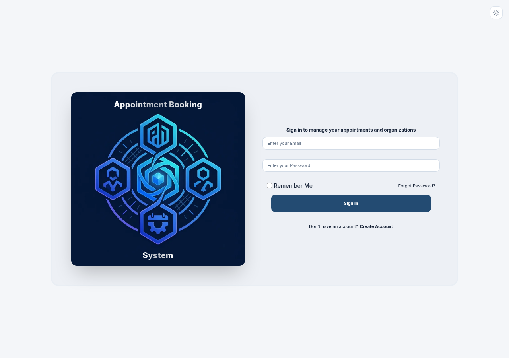
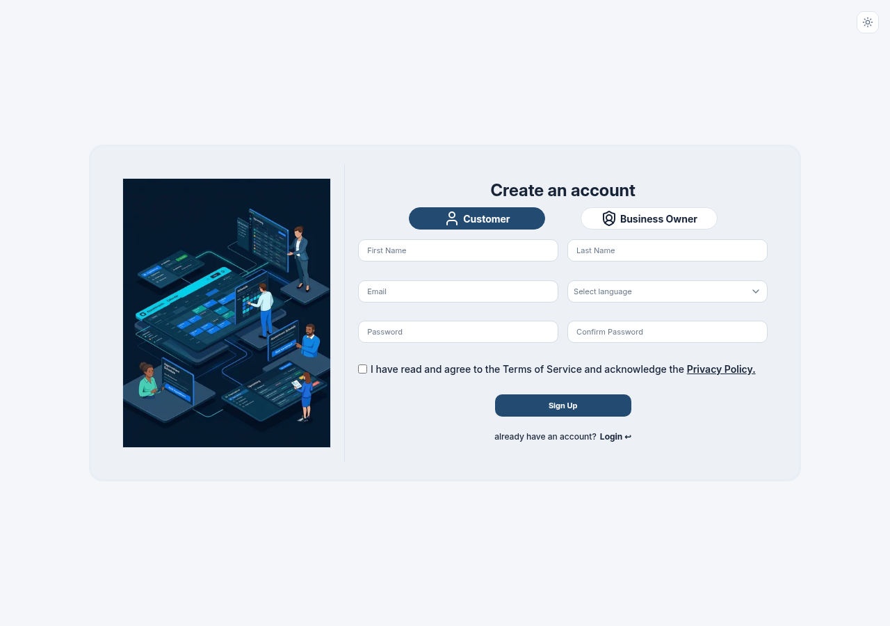

# Appointment Booking System · Client

React/TypeScript frontend for a multi-organization appointment booking platform. Customers browse services and rooms, find booking options, and manage appointments. Organization staff manage their services, schedules, rooms, and customers through role-based views.

[Live demo](https://appointment-booking-system-client.vercel.app/) · [Server source and setup](https://github.com/Amjad-Adi/Appointment_Booking_System_Server)

## Screenshots

These are real screenshots of the public authentication screens, captured from a local build with the proposed image optimization. No customer data or signed-in account is shown.




## Features and stack

- Customer booking, appointment history, favourites, and reviews.
- Organization and super-admin management views for users, organizations, services, rooms, and invitations.
- Map-based location selection with Leaflet and React Leaflet.
- Firebase authentication, Axios API calls with credential cookies, and React Query server state.
- React 19, TypeScript, React Router, Tailwind CSS, React Hook Form, and Zod schemas.
- Light/dark themes and responsive layouts.

## Run locally

1. Install a current Node.js LTS release and npm.
2. Clone and install:

   ```sh
   git clone https://github.com/Amjad-Adi/Appointment_Booking_System_Client.git
   cd Appointment_Booking_System_Client
   npm ci
   cp .env.example .env.local
   ```

3. In `.env.local`, set `VITE_NODE_ENV=development`, `VITE_CLIENT_PORT=8080`, `VITE_SERVER_PORT=3000`, and `VITE_DEVELOPMENT_SERVER=http://localhost`.
4. Supply the web-app Firebase configuration for your own project: `VITE_FIREBASE_API_KEY`, `VITE_FIREBASE_AUTH_DOMAIN`, `VITE_FIREBASE_PROJECT_ID`, `VITE_FIREBASE_STORAGE_BUCKET`, `VITE_FIREBASE_MESSAGING_SENDER_ID`, and **`VITE_FIREBASE_APP_ID`**. The current example omits the `VITE_` prefix on its final app-ID variable; the code requires it. Do not put Firebase Admin credentials in this client.
5. Configure and start the server using its README. Match the server's allowed client origin to `http://localhost:8080`.
6. Run `npm run dev` and open the local URL printed by Vite.

For a production build, set `VITE_PRODUCTION_SERVER` to the API origin before building. The client chooses the development API whenever Vite runs in development mode, regardless of `VITE_NODE_ENV`.

```sh
npm run build
npm run preview
npm run lint
```

The scripts build TypeScript and Vite output, preview it, and run ESLint. The repository does not currently define an automated test script. Firebase configuration is embedded in browser builds; Admin secrets and SMTP/Cloudinary secrets belong only on the server.

## Demo scope

The demo link was checked on 24 November 2026. Screenshots cover login and registration only. Signed-in booking, email delivery, and production API behavior were not exercised as part of this documentation update.
